<div align="center">


# INSTITUTO FEDERAL DE EDUCAÇÃO, CIÊNCIA E TECNOLOGIA DE SANTA CATARINA (IFSC) — CÂMPUS GASPAR

### Manual do Usuário — Aplicativo **Agenda 360**

**Versão:** 1.0  
**Atualizado em:** 11/2026  

**Autores:** Andrei Miguel Ludwig do Amaral e Kaiqui Ricardo Benevenutti  
**Repositório Frontend (Flutter):** https://github.com/AndreiLud7/Agenda360Front  
**Repositório Backend (Java / Spring Boot):** https://github.com/kaiquiBenevenutti/agenda360  

</div>

---

## Registro de Revisões

| Data | Versão | Responsáveis | Descrição |
| :--- | :---: | :--- | :--- |
| 24/11/2026 | 1.0 | Andrei Miguel Ludwig do Amaral, Kaiqui Ricardo Benevenutti | Elaboração inicial do Manual do Usuário do aplicativo Agenda 360 cobrindo todas as telas, filtros, painel financeiro e emissão de atestados em PDF. |

---

## Sumário

- [1. Introdução](#1-introdução)
- [2. Instalação e Requisitos](#2-instalação-e-requisitos)
  - [2.1 Requisitos do Sistema](#21-requisitos-do-sistema)
  - [2.2 Executando o Backend (Servidor API)](#22-executando-o-backend-servidor-api)
  - [2.3 Instalando e Executando o Aplicativo (Frontend Flutter)](#23-instalando-e-executando-o-aplicativo-frontend-flutter)
- [3. Agenda 360 — Guia de Uso das Telas](#3-agenda-360--guia-de-uso-das-telas)
  - [3.1 Tela Inicial (Home)](#31-tela-inicial-home)
  - [3.2 Seleção de Data para Agendamento (Agenda / Consultas)](#32-seleção-de-data-para-agendamento-agenda--consultas)
  - [3.3 Cadastrar Nova Consulta](#33-cadastrar-nova-consulta)
  - [3.4 Detalhes do Atendimento](#34-detalhes-do-atendimento)
  - [3.5 Editar Consulta](#35-editar-consulta)
  - [3.6 Listagem e Filtros de Clientes](#36-listagem-e-filtros-de-clientes)
  - [3.7 Painel Financeiro e Indicadores](#37-painel-financeiro-e-indicadores)
  - [3.8 Geração e Compartilhamento de Atestados (PDF)](#38-geração-e-compartilhamento-de-atestados-pdf)
- [4. Barra de Navegação e Atalhos](#4-barra-de-navegação-e-atalhos)
- [5. Regras de Validação e Comportamento dos Status](#5-regras-de-validação-e-comportamento-dos-status)
  - [5.1 Limites e Validações dos Campos](#51-limites-e-validações-dos-campos)
  - [5.2 Matriz de Status dos Atendimentos](#52-matriz-de-status-dos-atendimentos)
  - [5.3 Perfil de Acesso](#53-perfil-de-acesso)
- [Lista de Imagens](#lista-de-imagens)

---

## 1. Introdução

O **Agenda 360** é um aplicativo móvel desenvolvido em **Flutter (Dart)** integrado a uma API REST em **Java (Spring Boot)** e banco de dados **MySQL**, criado como projeto acadêmico no **Instituto Federal de Santa Catarina (IFSC) — Câmpus Gaspar**.

O sistema foi projetado para auxiliar a rotina clínica de atendimento em **Psicoterapia e Hipnoterapia** (atendendo às necessidades do profissional *Ricardo Benevenutti*), reunindo em uma única plataforma:

- Controle diário de agendamentos ativos por horário;
- Cadastro e edição completa de atendimentos (*Consulta*, *Terapia* e *Retorno*);
- Histórico completo de clientes com filtros combináveis por nome, dia, mês, ano, tipo e status;
- Painel financeiro com filtro de período e gráficos gerenciais (faturamento semanal, origem dos clientes, maiores causas de procura e funil de conclusão);
- Geração automática, visualização prévia e compartilhamento de **Atestados de Comparecimento em PDF**.

Este manual tem como objetivo orientar o usuário final quanto à instalação, configuração e utilização passo a passo de todas as funcionalidades do aplicativo.

---

## 2. Instalação e Requisitos

### 2.1 Requisitos do Sistema

Para utilizar o **Agenda 360** em ambiente de testes ou instalação local, são necessários:

- **Dispositivo / Emulador:** Smartphone Android (ou Emulador Android via Android Studio);
- **Servidor Backend:** Java **17** ou superior, Maven (ou Maven Wrapper incluso no projeto) e **MySQL Server** em execução na porta padrão `3306`;
- **Ambiente Flutter (para compilação/execução via código-fonte):** Flutter SDK (Dart `^3.13.1`) e Android Studio ou VS Code.

---

### 2.2 Executando o Backend (Servidor API)

O aplicativo consome os dados da API Spring Boot disponível no repositório [`agenda360`](https://github.com/kaiquiBenevenutti/agenda360).

1. Clone o repositório do backend:
   ```bash
   git clone https://github.com/kaiquiBenevenutti/agenda360.git
   cd agenda360
   ```
2. Certifique-se de que o serviço do **MySQL** esteja rodando em `localhost:3306` e configure as variáveis de ambiente de acesso ao banco (utilizadas em `src/main/resources/application.yaml`):
   - `DATABASE_USER`: usuário do MySQL (ex.: `root`)
   - `DATABASE_PASSWORD`: senha do MySQL

   > [!NOTE]
   > O banco de dados `agenda360` é criado automaticamente caso ainda não exista (`createDatabaseIfNotExist=true`), e as tabelas são atualizadas automaticamente mantendo os dados salvos (`ddl-auto: update`).

3. Inicie a aplicação Spring Boot:
   ```bash
   ./mvnw spring-boot:run
   ```
   No Windows (PowerShell/CMD):
   ```powershell
   .\mvnw.cmd spring-boot:run
   ```
4. A API estará disponível em `http://localhost:8080/v1/consultas` (com documentação interativa Swagger acessível em `http://localhost:8080/swagger-ui.html`).

---

### 2.3 Instalando e Executando o Aplicativo (Frontend Flutter)

O código-fonte do aplicativo está disponível no repositório [`Agenda360Front`](https://github.com/AndreiLud7/Agenda360Front).

1. Clone o repositório e acesse a pasta do projeto Flutter:
   ```bash
   git clone https://github.com/AndreiLud7/Agenda360Front.git
   cd Agenda360Front/agenda
   ```
2. Instale as dependências do aplicativo:
   ```bash
   flutter pub get
   ```
3. Verifique o endereço da API no arquivo `lib/services/consulta_service.dart`:
   - **No Emulador Android (padrão já configurado):** `http://10.0.2.2:8080/v1/consultas` (o IP `10.0.2.2` aponta automaticamente para o `localhost` do computador onde o emulador está rodando).
   - **Em smartphone Android físico (na mesma rede Wi-Fi):** substitua `10.0.2.2` pelo endereço IP local do computador onde o backend Java está rodando (ex.: `http://192.168.0.10:8080/v1/consultas`).
4. Execute o aplicativo no emulador ou celular conectado:
   ```bash
   flutter run
   ```
   *(Opcional)* Para gerar o arquivo instalador `.apk` para Android:
   ```bash
   flutter build apk --release
   ```

> [!IMPORTANT]
> O servidor Backend em Java deve estar em execução antes de abrir o aplicativo para que as consultas, os gráficos financeiros e a geração de atestados em PDF funcionem corretamente.

---

## 3. Agenda 360 — Guia de Uso das Telas

Ao abrir o aplicativo no dispositivo, o usuário acessa diretamente a tela inicial (**Home**), sem necessidade de etapas intermediárias, podendo alternar entre todos os módulos pela barra inferior fixa.

---

### 3.1 Tela Inicial (Home)

A **Home** é a tela principal do aplicativo e apresenta a pauta do dia selecionado, listando exclusivamente os **atendimentos ativos (marcados)** em ordem crescente de horário (do mais cedo para o mais tarde).

**Como utilizar:**
1. **Trocar a data exibida:** No topo central, a data aparece no formato `Dia da Semana - DD/MM` (ex.: `Terça - 24/11`) acompanhada de uma seta para baixo (`⌄`). Toque sobre a data para abrir o calendário e selecionar qualquer outro dia (de 2024 a 2030).
2. **Visualizar os horários do dia:** Cada agendamento ativo exibe o **horário em destaque** (ex.: `14:00`), o **nome do paciente seguido do tipo de atendimento** (`Nome - TIPO`) e o botão azul **`Detalhes`**.
3. **Abrir informações e ações:** Toque no botão **`Detalhes`** ao lado de qualquer atendimento para visualizar todos os dados, editar, finalizar ou cancelar a consulta.

> [!NOTE]
> Atendimentos já **finalizados** ou **cancelados** não aparecem na lista da tela Home para manter a visualização do dia limpa. Eles continuam disponíveis na aba **Clientes** (e os finalizados também na aba **Atestado**). Caso não haja agendamentos ativos no dia escolhido, a tela exibirá a mensagem *"Nenhuma consulta ativa para este dia."*

<div align="center">

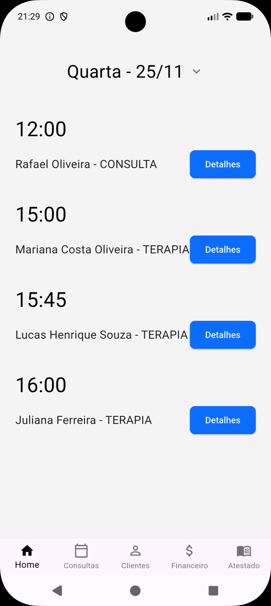

**Imagem 1.** Tela Inicial (Home) exibindo o seletor de data no topo e a lista de consultas ativas do dia.

</div>

---

### 3.2 Seleção de Data para Agendamento (Agenda / Consultas)

Para cadastrar um novo atendimento, toque na aba **Consultas** (ícone de calendário) na barra de navegação inferior.

**Como utilizar:**
1. Na tela **Agenda**, utilize o calendário exibido na tela para selecionar a data desejada para o atendimento.
2. Por segurança, o calendário bloqueia automaticamente a seleção de datas anteriores ao dia atual, permitindo agendar apenas a partir da data de hoje até o ano de 2030.
3. Com o dia selecionado, toque no botão azul **`Marcar consulta`** na parte inferior da tela para avançar ao formulário de cadastro.

<div align="center">

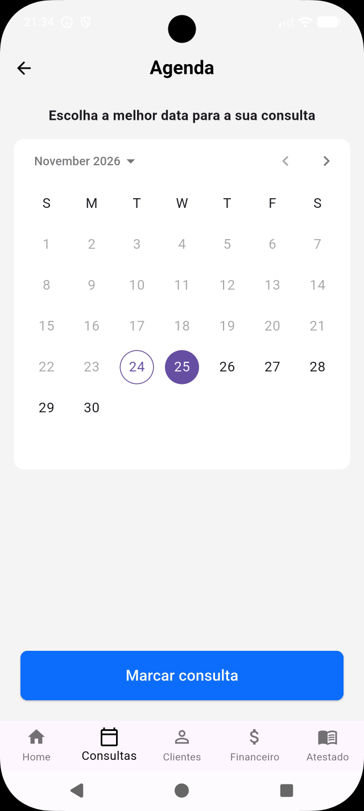

**Imagem 2.** Tela de Agenda para escolha da data do novo atendimento.

</div>

---

### 3.3 Cadastrar Nova Consulta

Após tocar em **`Marcar consulta`**, abre-se o formulário **Nova consulta**, exibindo no topo a data escolhida (`Nova consulta - DD/MM`).

**Preenchimento dos campos:**
- **Nome Completo** *(obrigatório)*: Digite o nome do paciente. Possui contador em tempo real no canto superior direito e limite de **70 caracteres** (`0/70`).
- **Telefone** *(opcional)*: Possui máscara automática no formato `+55 (##) #####-####`. Se preenchido, deve conter DDD + número válido (8 ou 9 dígitos).
- **Como conheceu** *(seleção única)*: Informe a origem do cliente escolhendo entre `Facebook`, `Instagram` *(padrão)*, `Recomendação` ou `Outros`.
- **Tipo** *(seleção única)*: Selecione o tipo de atendimento: `Consulta`, `Terapia` *(padrão)* ou `Retorno`.
- **Local** *(lista suspensa)*: Escolha entre `Gaspar` *(padrão)*, `Blumenau` ou `Outro`.
  - Caso escolha **`Outro`**, será exibido automaticamente o campo **Descrição do Local (Ex: Clínica no Centro)** *(obrigatório quando "Outro" está ativo, com limite de 100 caracteres — `0/100`)*.
- **Horário** *(formato 24h)*: Inicia em `12:00`. Toque sobre o campo ou no ícone de relógio para abrir o seletor de hora e minuto.
- **Valor (`R$`)** *(opcional)*: Formatação monetária automática de trás para frente (`0,00`), aceitando valores até `99.999.999,99`.
- **Motivo do contato** *(opcional)*: Descreva brevemente a causa da procura (limite de **300 caracteres** — `0/300`). Este campo alimenta automaticamente o gráfico *"Maior Causa de Procura"* no módulo Financeiro.

Ao finalizar o preenchimento, toque no botão azul **`Salvar`**. O aplicativo validará automaticamente todas as regras (incluindo bloqueio de horário já passado e conflito de horário com outra consulta ativa). Se tudo estiver correto, exibirá a notificação verde *"Salvo com sucesso!"* e retornará à tela **Home**.

> [!TIP]
> Ao rolar o formulário ou tocar em qualquer área livre fora dos campos de texto, o teclado do celular é fechado automaticamente para facilitar o acesso ao botão **Salvar**.

<div align="center">

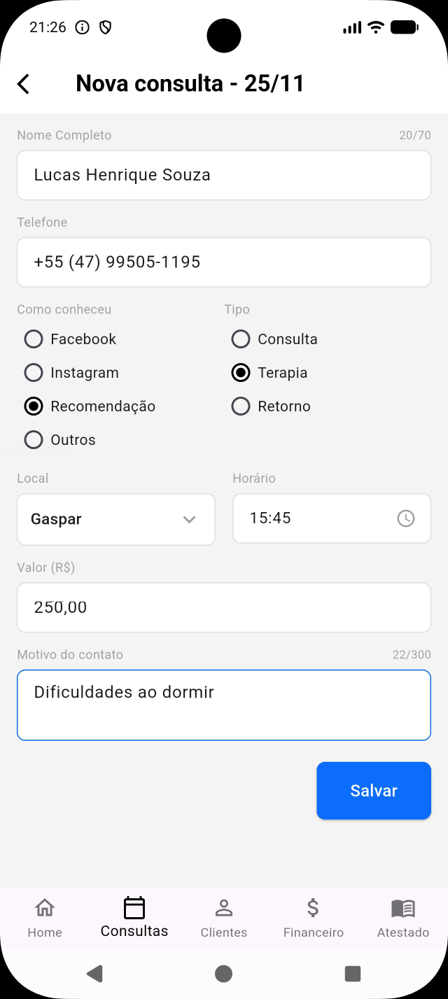

**Imagem 3.** Formulário de cadastro de Nova Consulta com contadores de caracteres e seletores.

</div>

<div align="center">

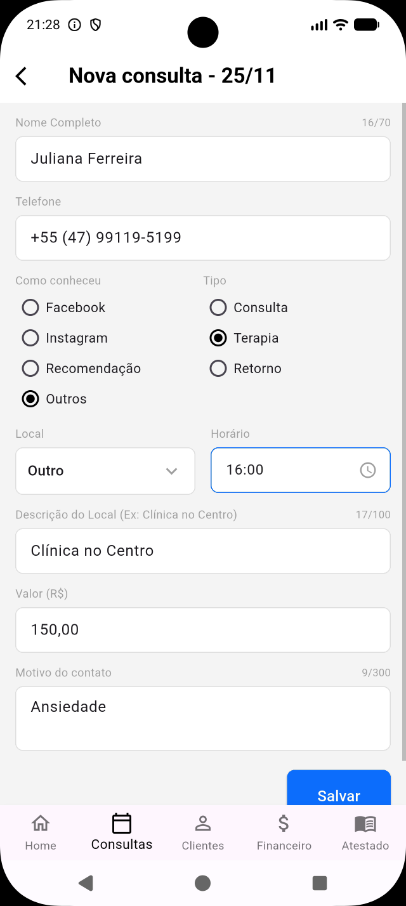

**Imagem 4.** Seleção da opção "Outro" no campo Local, exibindo o campo adicional de Descrição do Local.

</div>

---

### 3.4 Detalhes do Atendimento

A tela **Detalhes** permite consultar todas as informações de um agendamento e gerenciar o seu ciclo de vida. Ela pode ser aberta tanto pelo botão **`Detalhes`** na tela **Home** quanto pelo ícone de **olho (👁️)** na tela **Clientes**.

**Informações apresentadas:**
- **Cabeçalho:** Mostra `Local - DD/MM HH:mm`. Caso o nome do local/descrição seja longo e apareça abreviado com `...`, basta tocar sobre o título do cabeçalho para visualizar o texto completo em uma dica flutuante (*Tooltip*).
- **Dados do paciente e atendimento:** Nome completo, Tipo (*Consulta*, *Terapia* ou *Retorno*), Telefone (ou *"Não informado"* quando em branco), Como conheceu (*Instagram*, *Facebook*, *Recomendação* ou *Outros*), Valor formatado (`R$ 0,00`) e o **Motivo do contato**.

**Ações disponíveis na parte inferior:**
1. **`Cancelada`** *(botão vermelho)*: Altera o status do atendimento para cancelado (`Consulta cancelada`, `Terapia cancelada` ou `Retorno cancelado`). O registro é mantido no histórico da tela de Clientes para fins de controle e métricas, porém libera aquele horário na agenda.
2. **`Editar`** *(botão azul)*: Abre a tela de edição para modificar qualquer informação do atendimento (incluindo data e horário).
3. **`Finalizada`** *(botão preto)*: Conclui o atendimento (`Consulta finalizada`, `Terapia finalizada` ou `Retorno finalizado`). Após finalizar, o valor passa a compor o **Faturamento Total** no Financeiro e o atendimento fica liberado para gerar o PDF na aba **Atestado**.

<div align="center">

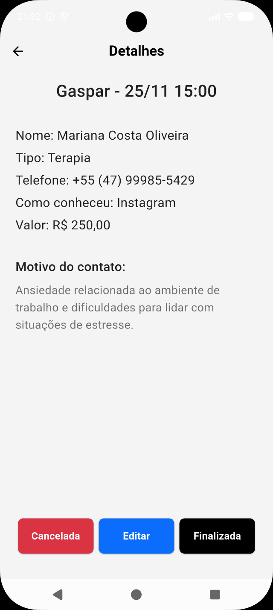

**Imagem 5.** Tela de Detalhes exibindo os dados completos do atendimento e os botões de ação (Cancelada, Editar e Finalizada).

</div>

---

### 3.5 Editar Consulta

Acessada através do botão azul **`Editar`** dentro da tela de Detalhes.

**Como utilizar:**
1. O topo da tela mostra o primeiro nome do paciente seguido da data atual da consulta (`PrimeiroNome - DD/MM`).
2. Todos os campos já vêm preenchidos com os dados atuais do atendimento, permitindo alterar:
   - **Nome Completo** (`0/70`) e **Telefone**;
   - **Como conheceu** e **Tipo**;
   - **Data** *(toque no campo com ícone de calendário para escolher um novo dia/mês/ano para remarcação)* e **Horário** *(ícone de relógio)*;
   - **Local** (e **Descrição do Local** `0/100`, se *Outro*);
   - **Valor (`R$`)** e **Motivo do contato** (`0/300`).
3. Toque no botão **`Salvar`** para gravar as alterações. O aplicativo verifica novamente se a nova data/horário não está no passado e se não colide com outro agendamento ativo.
4. Ao confirmar, a mensagem *"Consulta atualizada com sucesso!"* é exibida e a tela anterior é recarregada automaticamente.

<div align="center">

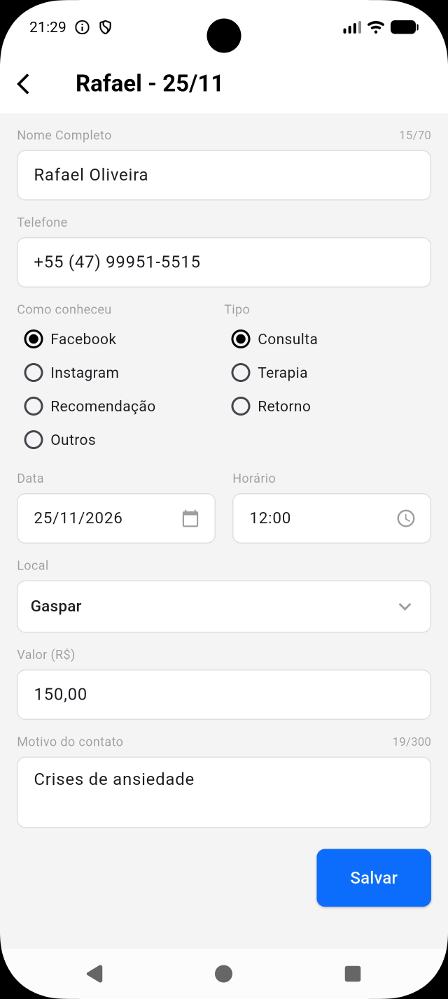

**Imagem 6.** Tela de Editar Consulta com campos para alterar Data, Horário e demais dados do paciente.

</div>

---

### 3.6 Listagem e Filtros de Clientes

Acessada pela aba **Clientes** (ícone de pessoa) na barra de navegação inferior. Esta tela exibe o histórico completo de atendimentos cadastrados, independentemente do status.

**O que é exibido em cada item:**
- **Nome do paciente** em destaque;
- **Data e horário do atendimento** (`DD/MM/AAAA às HH:mm`) logo abaixo do nome;
- **Status do atendimento** identificado por cor:
  - **Azul:** Atendimento ativo/marcado (*Consulta marcada*, *Terapia marcada*, *Retorno marcado*);
  - **Vermelho:** Atendimento cancelado (*Consulta cancelada*, *Terapia cancelada*, *Retorno cancelado*);
  - **Cinza escuro:** Atendimento finalizado (*Consulta finalizada*, *Terapia finalizada*, *Retorno finalizado*);
- **Ícone de olho (👁️):** Abre diretamente a tela de **Detalhes** daquele atendimento.

**Como utilizar os Filtros:**
1. Toque no ícone de **filtro** (três linhas decrescentes em azul, no canto superior direito da tela).
2. No painel **Filtrar Clientes**, você pode combinar livremente os seguintes filtros:
   - **Buscar por nome:** Digite qualquer parte do nome do paciente;
   - **Data da Consulta (Dia, Mês e Ano):** Três seletores independentes que iniciam em `Todos`. É possível:
     - Filtrar um **dia específico** (selecionando *Dia*, *Mês* e *Ano*);
     - Filtrar um **mês inteiro** (deixando *Dia* em `Todos` e selecionando apenas *Mês* e *Ano*);
     - Filtrar um **ano inteiro** (deixando *Dia* e *Mês* em `Todos` e selecionando apenas o *Ano*);
   - **Tipo de Atendimento:** Escolha entre `Todos`, `Consulta`, `Terapia` ou `Retorno`;
   - **Status:** Escolha entre `Todos`, `Marcada`, `Finalizada` ou `Cancelada`.
3. Os resultados são atualizados em tempo real. Toque em **`Aplicar e Fechar`** para visualizar a lista filtrada, ou toque em **`Limpar filtros`** (no topo direito do painel) para remover todos os filtros de uma vez.

<div align="center">

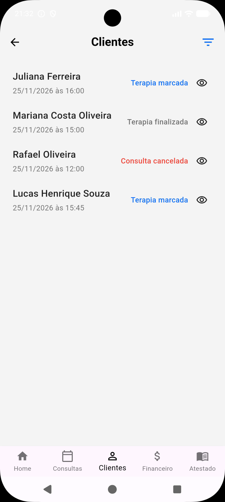

**Imagem 7.** Tela de Clientes listando pacientes, datas, status coloridos e ícone de visualização de detalhes.

</div>

<div align="center">

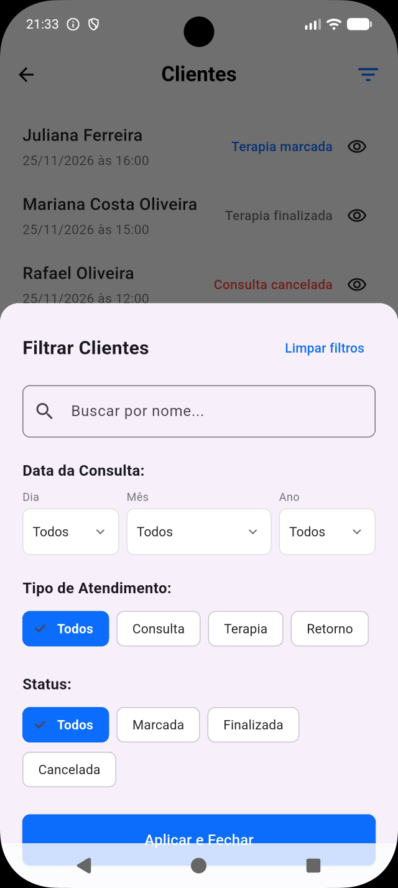

**Imagem 8.** Painel de filtros avançados por Nome, Data (Dia/Mês/Ano), Tipo de Atendimento e Status.

</div>

---

### 3.7 Painel Financeiro e Indicadores

Acessada pela aba **Financeiro** (ícone `$`) na barra inferior. Esta tela oferece uma visão gerencial do consultório com 4 gráficos interativos baseados no período escolhido.

**Filtro por período:**
- Ao abrir a tela, o período inicial é preenchido automaticamente com o **mês atual** (do dia `01` até o último dia do mês).
- Nos campos **`De`** e **`Até`**, o usuário pode:
  - **Digitar a data manualmente** no formato `DD/MM/AAAA` (com formatação automática das barras); ou
  - **Tocar no ícone de calendário** dentro de cada campo para escolher visualmente a data inicial e final.
- Toque no botão azul **`Buscar`** para recalcular os gráficos. Caso a data inicial seja posterior à data final ou possua formato inválido, o aplicativo exibirá um alerta em vermelho.

**Gráficos exibidos:**
1. **Faturamento total (Gráfico de Linha e Área):** Divide o intervalo filtrado em 4 faixas (`Semana 1`, `Semana 2`, `Semana 3` e `Semana 4`) e exibe o somatório em reais das consultas **finalizadas** em cada semana, com o valor numérico acima de cada ponto.
2. **Origem dos Clientes (Gráfico de Rosca):** Apresenta a distribuição proporcional dos canais pelos quais os clientes conheceram o serviço no período:
   - **Roxo:** Instagram
   - **Salmão:** Recomendação
   - **Ciano:** Facebook
   - **Laranja:** Outros
3. **Maior Causa de Procura (Gráfico de Barras Horizontais):** Exibe o ranking das **4 causas/motivos de contato** mais frequentes no período filtrado, mostrando a quantidade exata dentro de cada barra.
4. **Taxa de conclusão (Gráfico de Funil):** Demonstra a conversão dos atendimentos em três estágios com totais na legenda:
   - **Procuraram** *(roxo)*: Total de agendamentos registrados no período;
   - **Iniciaram** *(salmão)*: Atendimentos não cancelados (marcados + finalizados);
   - **Concluíram** *(ciano)*: Atendimentos efetivamente finalizados.

<div align="center">

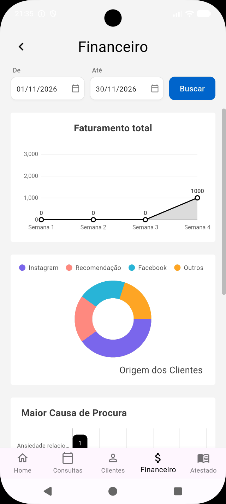

**Imagem 9.** Tela Financeiro exibindo o filtro de período (De/Até), o gráfico de Faturamento Total e o gráfico de Origem dos Clientes.

</div>

<div align="center">

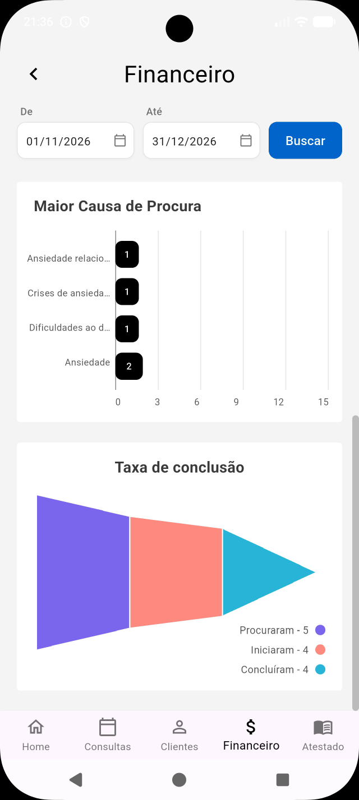

**Imagem 10.** Tela Financeiro exibindo os gráficos de Maior Causa de Procura e Taxa de Conclusão (funil).

</div>

---

### 3.8 Geração e Compartilhamento de Atestados (PDF)

Acessada pela aba **Atestado** (ícone de caderno/livro) na barra inferior.

Esta tela lista **somente os atendimentos com status finalizado** (`Consulta finalizada`, `Terapia finalizada` ou `Retorno finalizado`), no formato `Nome do Paciente - Tipo DD/MM/AAAA`.

**Ações disponíveis em cada registro:**
1. **Visualizar Prévia (ícone de olho 👁️):**
   - Solicita ao servidor a geração do documento em PDF e abre uma tela de **Prévia** (`Prévia: Nome do Paciente`) com visualizador integrado, permitindo conferir o documento com zoom antes de enviar.
   - No canto superior direito da tela de prévia, há também um botão de **Compartilhar / Salvar** para exportar o arquivo diretamente.
2. **Compartilhar / Baixar Direto (ícone de compartilhar 🔗):**
   - Gera o arquivo `atestado_Nome_Paciente.pdf` e abre imediatamente o menu de compartilhamento do Android, permitindo enviar o atestado pelo WhatsApp, E-mail, salvar no Google Drive ou armazenar no aparelho.

**Informações preenchidas automaticamente no PDF:**
- Logomarca profissional (*Ricardo Hipnoterapeuta*) no cabeçalho;
- Título **"Atestado de Comparecimento"**;
- Texto formal contendo o nome do paciente, a data do atendimento por extenso, o **período do dia** calculado automaticamente pelo horário da consulta (*matutino* antes das 12h, *vespertino* entre 12h e 17h59, *noturno* a partir das 18h), o tipo de atendimento (*consulta* ou *terapia de Hipnoterapia*) e a cidade do atendimento;
- Data de emissão atual e assinatura profissional (*Ricardo Benevenutti — Psicoterapeuta/Hipnoterapeuta, IRT 18307, CNPJ*).

> [!IMPORTANT]
> Para que um atendimento apareça na tela **Gerar Atestado**, é necessário primeiro marcá-lo como **Finalizada** na tela de **Detalhes** (Seção 3.4).

<div align="center">

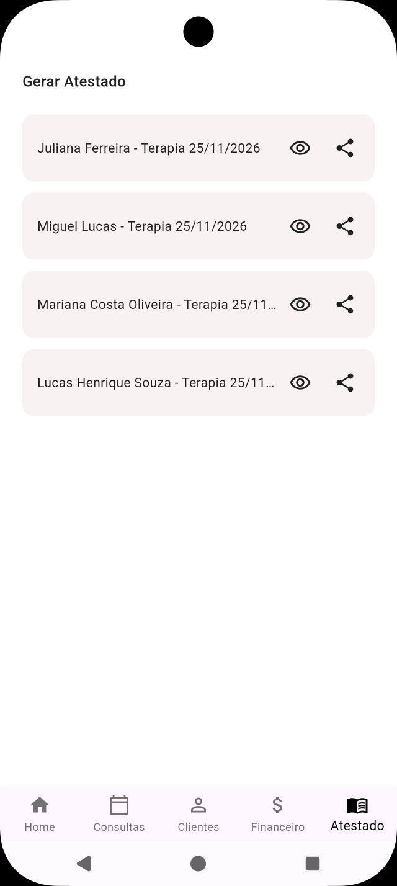

**Imagem 11.** Tela Gerar Atestado listando os atendimentos finalizados com botões de prévia (olho) e compartilhamento.

</div>

<div align="center">

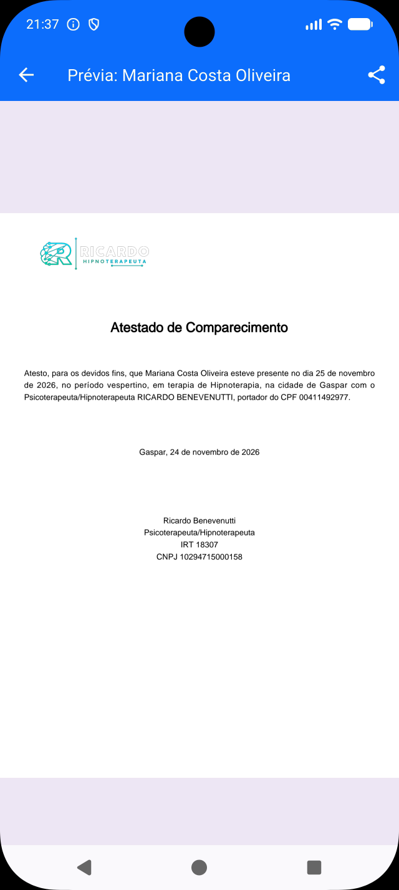

**Imagem 12.** Tela de prévia do Atestado de Comparecimento em PDF gerado automaticamente pelo sistema.

</div>

---

## 4. Barra de Navegação e Atalhos

Todas as telas principais do **Agenda 360** mantêm fixa na parte inferior a **Barra de Navegação (`BottomNavigationBar`)**, permitindo alternar rapidamente entre os 5 módulos do aplicativo com apenas um toque:

| Aba | Ícone | Função Principal |
| :--- | :---: | :--- |
| **Home** | 🏠 Casa | Exibe a agenda ativa do dia selecionado com acesso rápido aos detalhes. |
| **Consultas** | 📅 Calendário | Abre o calendário para escolher uma data e agendar uma nova consulta. |
| **Clientes** | 👤 Pessoa | Lista todo o histórico de atendimentos com filtros avançados e acesso aos detalhes. |
| **Financeiro** | 💲 Cifrão | Exibe o painel gerencial com 4 gráficos filtráveis por período (`De` / `Até`). |
| **Atestado** | 📖 Livro | Lista atendimentos finalizados para visualizar, baixar ou compartilhar atestados em PDF. |

**Atalhos e facilidades adicionais:**
- **Toque no cabeçalho da tela Detalhes:** Exibe o endereço/descrição completa do local caso esteja abreviado com `...`.
- **Botão `Limpar filtros` (Tela Clientes):** Redefine simultaneamente nome, dia, mês, ano, tipo e status para o estado inicial.
- **Atualização automática no Financeiro:** Ao concluir a digitação de duas datas válidas (`DD/MM/AAAA`) nos campos `De` e `Até`, ou ao confirmar uma data pelo calendário, os gráficos são atualizados automaticamente.
- **Recolhimento automático do teclado:** Rolar a página ou tocar fora dos campos de texto nas telas de cadastro, edição e financeiro fecha o teclado do smartphone.

---

## 5. Regras de Validação e Comportamento dos Status

### 5.1 Limites e Validações dos Campos

Para garantir a integridade dos dados gravados no banco de dados MySQL e evitar agendamentos incorretos, o aplicativo aplica as seguintes validações antes de salvar ou editar um atendimento:

| Campo / Regra | Obrigatoriedade | Regra / Limite Aplicado |
| :--- | :---: | :--- |
| **Nome Completo** | Obrigatório | Não pode ficar vazio. Limite máximo de **70 caracteres** (com contador `0/70`). |
| **Telefone** | Opcional | Máscara `+55 (##) #####-####`. Se preenchido, exige DDD + 8 ou 9 dígitos (12 ou 13 números no total). |
| **Descrição do Local** | Condicional | Obrigatório apenas quando o campo **Local** for igual a `Outro`. Limite de **100 caracteres** (`0/100`). |
| **Valor (`R$`)** | Opcional | Formatação monetária automática. Limite de **10 dígitos** (`99.999.999,99`). |
| **Motivo do contato** | Opcional | Limite máximo de **300 caracteres** (com contador `0/300`). |
| **Horário no passado** | Regra ativa | Impede agendar ou editar um atendimento para uma data/hora anterior ao momento atual. |
| **Conflito de horário** | Regra ativa | Impede marcar dois atendimentos ativos (`Marcada`/`Marcado`) exatamente no mesmo dia e horário (`HH:mm`). Horários de consultas canceladas ficam automaticamente livres. |

---

### 5.2 Matriz de Status dos Atendimentos

O aplicativo não exclui registros permanentemente do banco de dados; todo atendimento evolui por meio de status vinculados ao seu tipo (*Consulta*, *Terapia* ou *Retorno*). A tabela abaixo resume o comportamento de cada estado no sistema:

| Comportamento no Sistema | Marcada / Marcado (Ativo) | Finalizada / Finalizado | Cancelada / Cancelado |
| :--- | :---: | :---: | :---: |
| Aparece na tela **Home** (agenda do dia) | **X** | | |
| Bloqueia o mesmo dia e horário contra conflito | **X** | | |
| Aparece na tela **Clientes** (histórico e filtros) | **X** | **X** | **X** |
| Cor de exibição na tela **Clientes** | Azul | Cinza escuro | Vermelho |
| Contabiliza em **"Procuraram"** no funil Financeiro | **X** | **X** | **X** |
| Contabiliza em **"Iniciaram"** no funil Financeiro | **X** | **X** | |
| Contabiliza em **"Concluíram"** e no **Faturamento Total** | | **X** | |
| Disponível para gerar **Atestado em PDF** | | **X** | |

---

### 5.3 Perfil de Acesso

O **Agenda 360** foi desenvolvido como uma ferramenta de uso individual voltada diretamente ao **Profissional Terapeuta (Usuário Único)**, concedendo acesso direto e integral a todas as funcionalidades de agenda, gestão de clientes, painel financeiro e emissão de atestados sem necessidade de telas de login ou separação por múltiplos perfis.

---

## Lista de Imagens

- **Imagem 1:** Tela Inicial (Home) com consultas ativas do dia — `docs/imagens/01_home.png`
- **Imagem 2:** Tela de Agenda (seleção de data no calendário) — `docs/imagens/02_agenda_calendario.png`
- **Imagem 3:** Formulário de Nova Consulta — `docs/imagens/03_nova_consulta.png`
- **Imagem 4:** Nova Consulta com Local "Outro" selecionado — `docs/imagens/04_nova_consulta_local_outro.png`
- **Imagem 5:** Tela de Detalhes da Consulta — `docs/imagens/05_detalhes_consulta.png`
- **Imagem 6:** Tela de Edição de Consulta — `docs/imagens/06_editar_consulta.png`
- **Imagem 7:** Tela de Clientes (listagem e status) — `docs/imagens/07_clientes_lista.png`
- **Imagem 8:** Painel de Filtros Avançados de Clientes — `docs/imagens/08_clientes_filtros.png`
- **Imagem 9:** Tela Financeiro (Filtro de período, Faturamento Total e Origem dos Clientes) — `docs/imagens/09_financeiro_parte1.png`
- **Imagem 10:** Tela Financeiro (Maior Causa de Procura e Taxa de Conclusão) — `docs/imagens/10_financeiro_parte2.png`
- **Imagem 11:** Tela Gerar Atestado (lista de atendimentos finalizados) — `docs/imagens/11_atestado_lista.png`
- **Imagem 12:** Prévia do Atestado de Comparecimento em PDF — `docs/imagens/12_atestado_previa_pdf.png`
