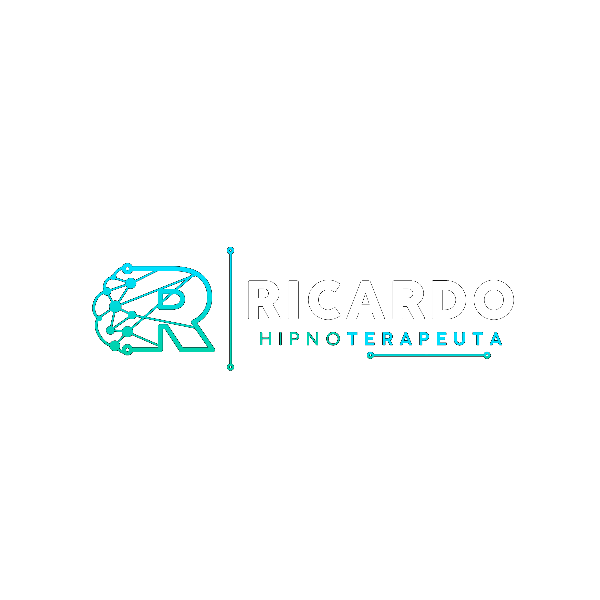

# Agenda 360 — Aplicativo Mobile (Flutter)

Aplicativo móvel desenvolvido em **Flutter** para gestão de agenda clínica, controle de pacientes, painel financeiro com gráficos e emissão de atestados em PDF.

---

## 📖 Documentação

- **[Manual do Usuário (MANUAL_USUARIO.md)](MANUAL_USUARIO.md)** — Guia completo passo a passo de instalação, uso de todas as telas, filtros, gráficos financeiros, emissão de atestados em PDF e regras de negócio.

## 🔗 Repositórios do Projeto

- **Frontend (Flutter / Dart):** https://github.com/AndreiLud7/Agenda360Front
- **Backend (Java / Spring Boot + MySQL):** https://github.com/kaiquiBenevenutti/agenda360

## 🚀 Principais Funcionalidades

- **Home:** Visualização da pauta diária ordenada por horário com seletor de datas.
- **Agendamento e Edição:** Cadastro e remarcação de *Consultas*, *Terapias* e *Retornos* com validação de campos, bloqueio de horários passados e detecção de conflitos de agenda.
- **Clientes e Filtros:** Histórico completo com status coloridos, acesso rápido aos detalhes e filtros combináveis por Nome, Dia, Mês, Ano, Tipo e Status.
- **Financeiro:** Painel com filtro por período (`De` / `Até`) e 4 gráficos gerenciais (*Faturamento total*, *Origem dos Clientes*, *Maior Causa de Procura* e *Taxa de conclusão*).
- **Atestados em PDF:** Geração automática, prévia integrada no app e compartilhamento de Atestados de Comparecimento para atendimentos finalizados.

## 👥 Autores

- Andrei Miguel Ludwig do Amaral
- Kaiqui Ricardo Benevenutti

Projeto desenvolvido no **Instituto Federal de Santa Catarina (IFSC) — Câmpus Gaspar**.
